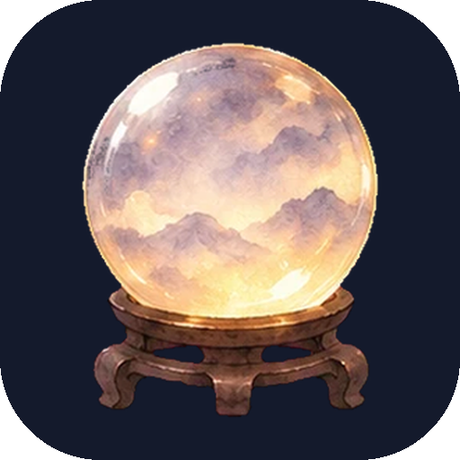
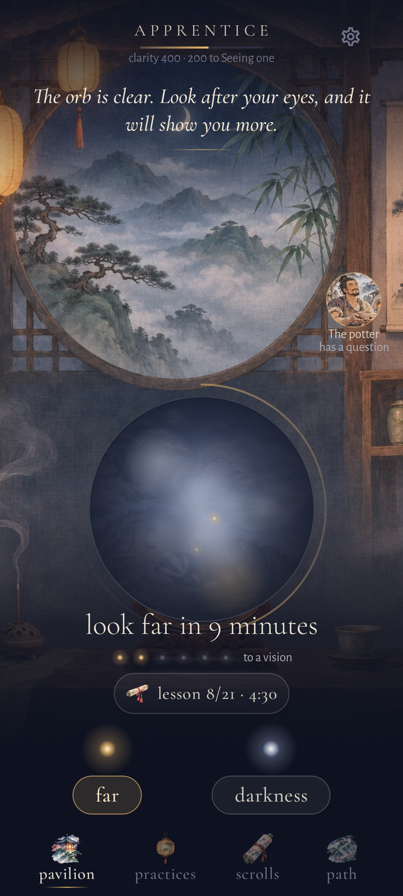
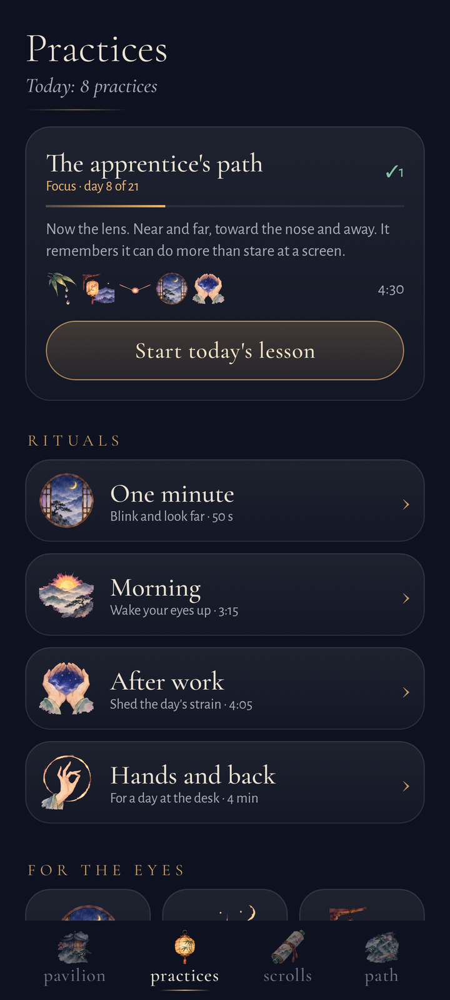
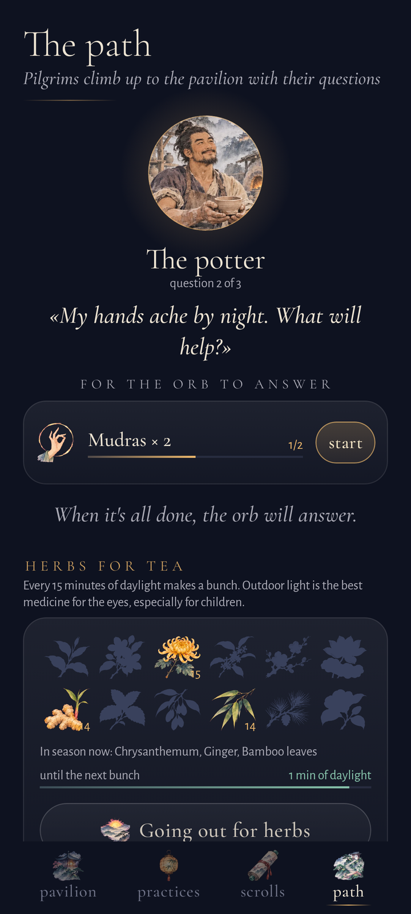
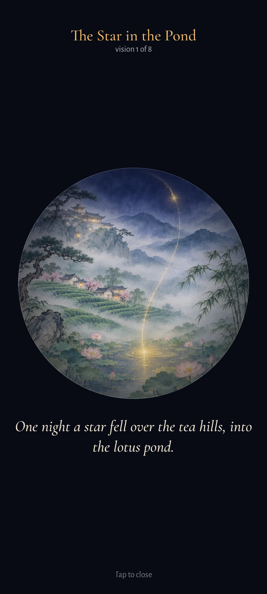
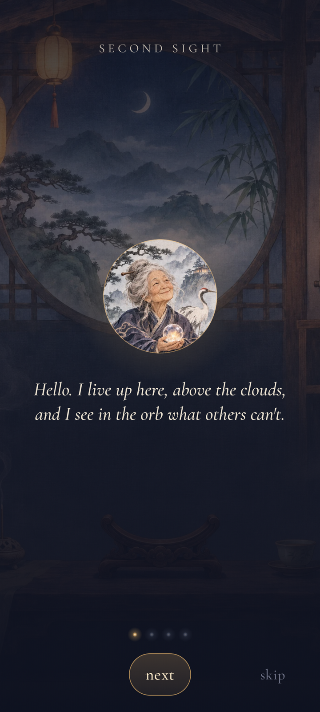
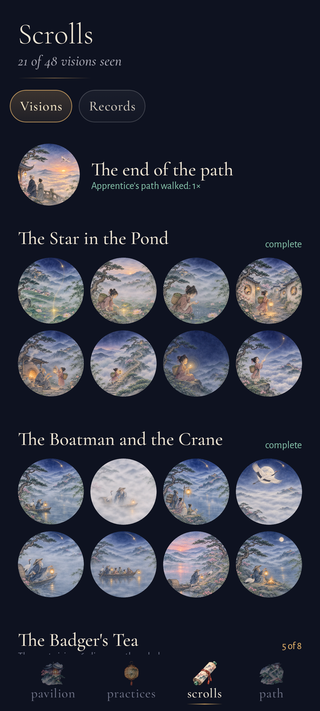
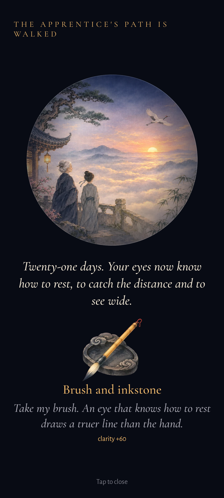
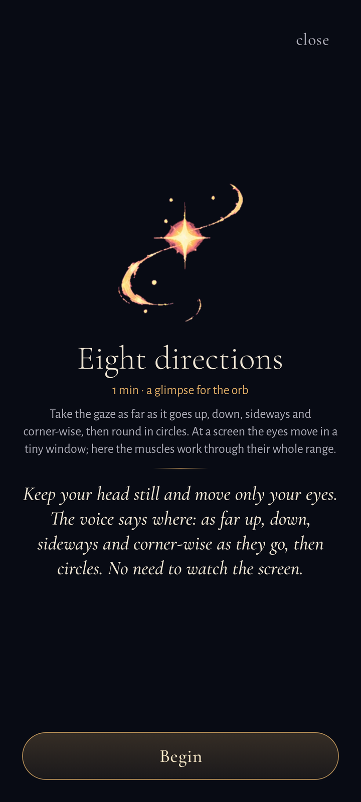

<p align="center"></p>

<h1 align="center">Second Sight</h1>

<p align="center">Eye breaks, eye exercises and tales in a crystal orb.<br>
<a href="https://bigdevwhale.github.io/stillcraft/apps/secondsight/">Website</a> · <a href="https://github.com/bigdevwhale/secondsight/releases/latest/download/SecondSight.apk">Download APK</a> · <a href="README.ru.md">Русский</a></p>

High in the mountains, above the clouds, lives an old seer, and you are her apprentice. While you look at a screen, her crystal orb slowly fills with mist. When the mist gets thick, she calls you: time to look far away. Twenty seconds at the window and the orb is clear again, with a glimpse left inside. Gather six glimpses, cover your eyes with your palms for a minute in the dark, and the orb shows you a vision from a tale.

<p align="center">




</p>

## What's inside

- **The orb mists with screen time.** The app counts how long the screen was on. While the phone lies still, your eyes rest and the mist clears. At a computer, turn on «I'm at the computer» and the orb mists by the clock instead.
- **One-tap reminder.** Tap «Look far» and the exercise is already running. Snooze for 10 minutes or an hour. No calls during phone calls, at night or while the app is open.
- **Twelve practices.** Look far; «Eight directions» and «Two lanterns», the gaze as far as it goes every way; «Dew» for blinking; «Near and far»; «The third eye»; «Side vision»; «Darkness», palms over the eyes. For the body: «Mudras» for the hands, «Bamboo» for neck and shoulders, «The bowl» for breathing. And in the evening, «Put out the lantern»: say goodnight to the screen.
- **Works with your eyes closed.** The seer says what to do aloud, and a bell and a buzz mark each change. In rituals the next exercise starts by itself.
- **The apprentice's path.** A 21-day course: one lesson a day, 2–8 minutes, from simple rest to eye movement and side vision. Walk it to the end and the seer gives you a gift.
- **Six tales, eight visions each.** A star fallen into a lotus pond, a boatman and his crane, a badger who grows tea, and more.
- **Pilgrims.** Each day someone climbs to the pavilion with a question: a goatherd, a teahouse keeper, a potter, a bride. The orb answers once you've done a few practices, and in time each pilgrim leaves a gift.
- **Herbs for tea.** Every 15 minutes in daylight brings a bunch of a seasonal herb. The light sensor notices when you're outdoors, or you can mark a walk by hand.
- **Widget and tile.** The orb on your home screen shows how long until the next look far. The «Darkness» quick-settings tile starts palming at once.
- No penalties, no streaks: a missed day takes nothing away. English and Russian.

<p align="center">




</p>

Second Sight is not medical treatment and doesn't replace a doctor. It reminds you to take breaks, to blink and to get more daylight. If your sight gets worse or your eyes hurt, see an eye doctor.

## Install

Download [SecondSight.apk](https://github.com/bigdevwhale/secondsight/releases/latest/download/SecondSight.apk) on a phone with Android 9 or newer, open it and allow the install when Android asks.

On Xiaomi, Huawei and some other phones, let the app run in the background and exempt it from battery saving, or reminders may not arrive. The app's settings have buttons for both.

## Privacy

No ads, accounts or analytics. The app needs no internet: all progress stays on your phone. A service with a quiet notification counts screen time. Details in [PRIVACY.md](PRIVACY.md).

## Build

You need JDK 17+ (Android Studio's JBR works) and the Android SDK.

```
./gradlew assembleDebug
./gradlew assembleDebug -Pdemo -Pdemolang=en   # app.secondsight.demo: three weeks of practice
./gradlew testDebugUnitTest
./gradlew testDebugUnitTest -Prender            # screen renders in app/build/art
```

Kotlin, Jetpack Compose. The seer, pilgrims, tales and objects were drawn with image generation (`tools/gen_art.py`, `tools/cut.py`).

## License

MIT, see [LICENSE](LICENSE).

Second Sight is one of the [StillCraft](https://bigdevwhale.github.io/stillcraft/) apps.
