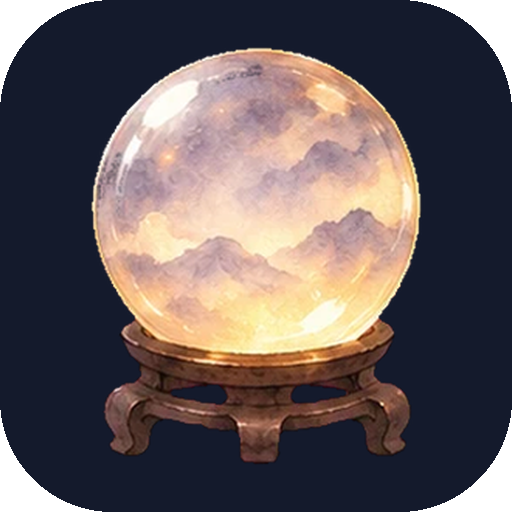
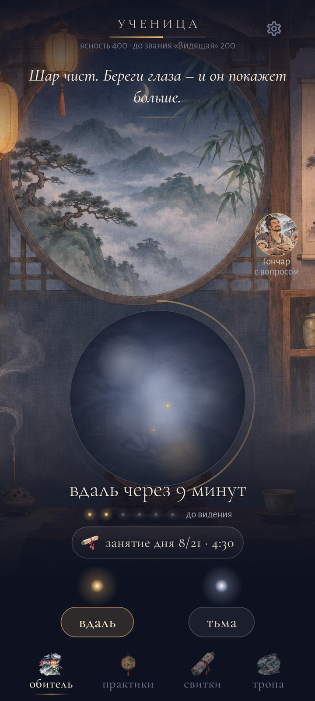
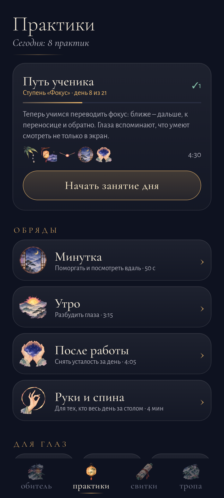
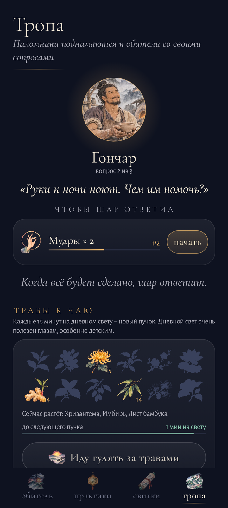
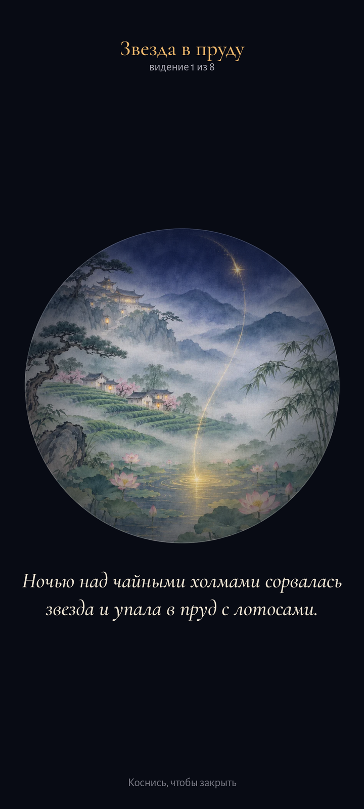
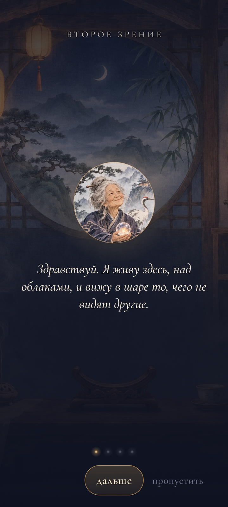
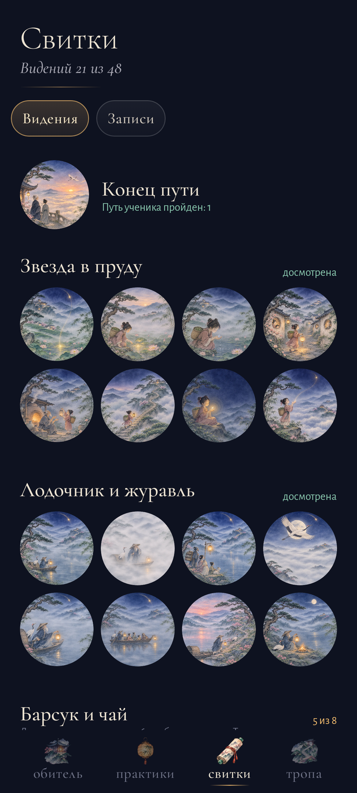
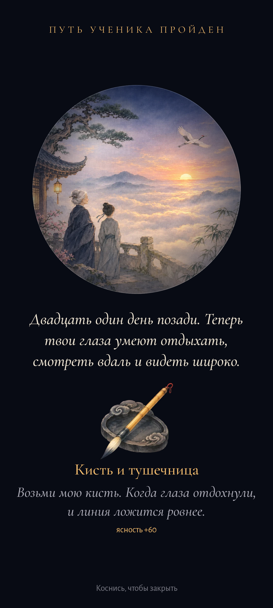
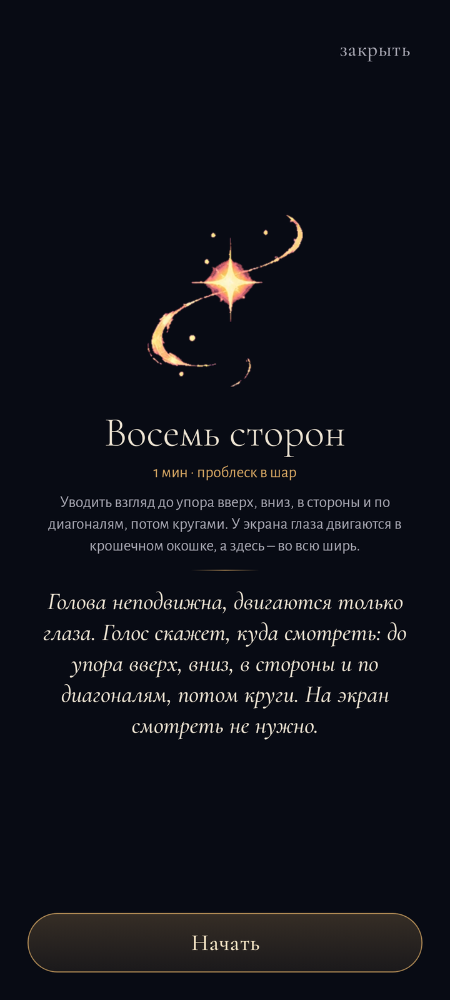

<p align="center"></p>

<h1 align="center">Второе зрение</h1>

<p align="center">Напоминает давать глазам отдых от экрана – и превращает перерывы в сказку.<br>
<a href="https://bigdevwhale.github.io/stillcraft/apps/secondsight/">Сайт</a> · <a href="https://github.com/bigdevwhale/secondsight/releases/latest/download/SecondSight.apk">Скачать APK</a> · <a href="README.md">English</a></p>

Приложение считает, сколько вы смотрите в экран, и вовремя напоминает дать глазам отдых: посмотреть вдаль, поморгать, посидеть с закрытыми глазами. Чтобы перерывы не надоедали, они превращены в игру: шар старой провидицы мутнеет, пока вы в телефоне, светлеет после отдыха и показывает картинки из сказок.

Вы – ученик провидицы, которая живёт высоко в горах. Двадцать секунд взгляда в окно – и её шар снова чист, а в нём остаётся проблеск. Наберётся шесть проблесков – закройте глаза ладонями, посидите минуту в темноте, и шар покажет картинку из сказки.

<p align="center">




</p>

## Что внутри

- **Шар туманится от экрана.** Приложение считает, сколько был включён экран. Пока телефон лежит, глаза отдыхают и туман рассеивается. Если вы работаете за компьютером, включите «Я за компьютером» – тогда шар туманится просто по часам.
- **Напоминание в одно касание.** Нажали «Вдаль» – и упражнение уже идёт. Можно отложить на 10 минут или на час. Во время звонка, ночью и пока приложение открыто, шар не зовёт.
- **Двенадцать практик.** Взгляд вдаль; «Восемь сторон» и «Два фонаря» – взгляд до упора во все стороны; «Роса» – моргание; «Близко и далеко»; «Третий глаз»; «Боковое зрение»; «Тьма» – ладони на глазах. Для тела: «Мудры» для кистей, «Бамбук» для шеи и плеч, «Чаша» для дыхания. А вечером «Погасить фонарь» – попрощаться с экраном до утра.
- **Можно делать с закрытыми глазами.** Провидица говорит вслух, что делать, а звон и вибрация отмечают каждую смену. В обрядах следующее упражнение начинается само.
- **Путь ученика.** Курс на 21 день: каждый день одно занятие на 2–8 минут, от простого отдыха к движениям глаз и боковому зрению. За пройденный путь провидица дарит подарок.
- **Шесть сказок, в каждой восемь видений.** Про звезду, которая упала в пруд с лотосами, про лодочника и журавля, про барсука, который растит чай, и другие.
- **Паломники.** Каждый день к обители поднимается кто-нибудь с вопросом: пастушок, хозяйка чайной, гончар, невеста. Чтобы шар ответил, нужно сделать несколько практик. Получив ответ, паломник однажды оставит подарок.
- **Травы к чаю.** Каждые 15 минут на дневном свету дают пучок травы по сезону. Датчик освещённости сам замечает, что вы на улице, а прогулку можно отметить и вручную.
- **Виджет и плитка.** Шар на главном экране показывает, сколько осталось до взгляда вдаль. Плитка «Тьма» в шторке сразу запускает отдых под ладонями.
- Без штрафов и серий: пропущенный день ничего не отнимает. Русский и английский.

<p align="center">




</p>

Приложение не лечит и не заменяет врача. Оно напоминает делать перерывы, моргать и чаще бывать на дневном свету. Если зрение падает или глаза болят, сходите к офтальмологу.

## Установка

Скачайте [SecondSight.apk](https://github.com/bigdevwhale/secondsight/releases/latest/download/SecondSight.apk) на телефон с Android 9 или новее, откройте файл и разрешите установку, когда Android спросит.

На Xiaomi, Huawei и некоторых других телефонах разрешите приложению работать в фоне и не экономьте на нём батарею, иначе напоминания могут не приходить. Кнопки для этого есть в настройках приложения.

## Конфиденциальность

Без рекламы, аккаунтов и аналитики. Приложению не нужен интернет: весь прогресс хранится только на телефоне. Чтобы считать время у экрана, работает служба с тихим уведомлением. Подробнее – в [PRIVACY.md](PRIVACY.md).

## Сборка

Нужны JDK 17+ (подойдёт JBR из Android Studio) и Android SDK.

```
./gradlew assembleDebug
./gradlew assembleDebug -Pdemo -Pdemolang=ru   # app.secondsight.demo: три недели практик
./gradlew testDebugUnitTest
./gradlew testDebugUnitTest -Prender            # скриншоты экранов в app/build/art
```

Kotlin, Jetpack Compose. Провидица, паломники, сказки и предметы нарисованы с помощью генерации изображений (`tools/gen_art.py`, `tools/cut.py`).

## Лицензия

MIT, см. [LICENSE](LICENSE).

Второе зрение – одно из приложений [StillCraft](https://bigdevwhale.github.io/stillcraft/).
